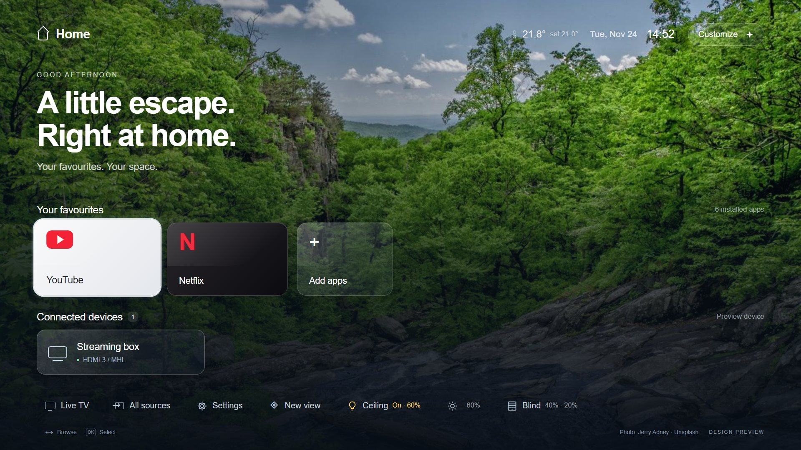

# Philips TV SAPHI Custom Home: TPM206E / 43PUS7855/12 fork

This is a fork of [UAEpro/philips-tv-saphi-os-jailbreak](https://github.com/UAEpro/philips-tv-saphi-os-jailbreak),
adapted to a different Philips TV and firmware family. All of the design, the
custom Home UI and the original method are the upstream author's work. This
fork changes only what was needed to make it run on the model below.



*Browser preview with example data (sample apps and device, simulated Gira
values). On the TV it shows your own apps, inputs and smart-home state.*

> **Tested on exactly one TV:**
> **Philips 43PUS7855/12**, software **TPM206E_201.003.248.001**
> (MediaTek MT5806, 2020 SAPHI platform, browser = Chrome 55).
>
> It has **not** been tested on any other model or firmware version. The
> installer refuses to run on any other model name. Other TPM206E models may be
> similar, but treat them as unknown until you have checked them yourself (see
> [Adapting to another TV](#adapting-to-another-tv)). For the original
> 65PUT6703/56 (TPM186E), use the [upstream repository](https://github.com/UAEpro/philips-tv-saphi-os-jailbreak).

The custom Home runs inside the TV's existing Philips dashboard and is saved
in the dashboard's browser storage. Nothing is flashed, no root access is gained,
and no firmware files are changed. Everything can be undone with one command
plus a TV restart. Use this only on a TV you own.

## What is different from upstream (TPM186E → TPM206E)

| Topic | Upstream TPM186E | This fork, TPM206E |
| --- | --- | --- |
| Page that renders the DLNA title (entry point) | `dash/index.html` | `ContentBrowser/content_browser.html` |
| Home dashboard | `/3rd/html5/php/dash/index.html` | same path (verified) |
| `TV_JSP` global | present | **missing** |
| `getTvJspService()` | nested: `.utility`, `.tvServices`, `.mmpServices` | **flat**: all methods at the top level |
| `advMsg('smallAdv','SEND_EVENT …')` | runs in the separate promotion window | **blanks the dashboard itself** (black screen), so it is skipped |
| How the installer reaches the dashboard | opens it with `notifyOpenUrl` | writes shared `localStorage` from the content browser; the hook starts the UI the next time **HOME** is pressed |

Code changes:

- `native-home/session.js`, `home-app/bridge.js`: accept a missing `TV_JSP`, and
  add a small `nhSvc()` adapter that presents the flat service as the nested
  shape the upstream code expects. Skip the promotion `SEND_EVENT` style
  injection when the service is flat (only the native `HIDE_WIN` remains).
- `native-home/install.js`, `native-home/restore.js`: run from the content browser
  page. The backup is sent to the computer synchronously before anything is written.
  The installer refuses to run if the menu is already patched but no backup exists.
- `native-home/session.js`: also writes its events to a ring buffer in TV storage
  (`compact-home.log.v1`) and records a render visibility check, so failures
  can be read back even when the dashboard cannot reach the computer.
- `native-home/logs.js` + `python native_home.py logs`: read that log back.
- `native_home.py`: model check set to `43PUS7855/12`; clears a stuck DLNA
  session first; synchronous bootstrap on the content browser; waits for
  `installed`, then for `ready` after you press HOME. **Ctrl+C keeps the custom
  Home installed**; only `recover` (or `stop`) restores Philips Home. All file
  I/O is UTF-8, so it works on Windows.
- `home-app/app.js`, `config.js`: optional `euSummerTime` (automatic EU
  daylight saving) and `clock24h` settings.
- `gira_bridge.py` + `smartHome` setting: optional Gira X1 lights, blinds and read-only temperature (see below).
- `home-app/index.html`, `app.css`: the ✦ and ⚙ symbols are missing from the
  TV's fonts, so they are replaced with inline SVG icons.

### How the TPM206E hook was verified

A test-only build planted harmless markers in several menu fields. Each marker
only recorded "I ran" in `localStorage`. The results:

- The dashboard builds the tile icon as `` with `innerHTML`
  and double quotes. A marker appended to `itemImg` of the **Reorder** tiles fires
  in `dash/index.html`. Markers in `backGroundIcon` and `HelpText` never fire.
- The markers survive a full cold restart (TV off, power unplugged, back on).
- The dashboard partly rewrites `IHSMenuItems` itself, but the Reorder entries
  were kept every time.

## Requirements

- A **Philips 43PUS7855/12 on TPM206E_201.003.248.001**. Check under
  Settings → General Settings → About / Software version.
- A computer on the **same local network** as the TV, with **Python 3**
  (standard library only). Node.js is needed only to run the tests.
- The TV's LAN address and the computer's LAN address (examples below use
  `192.168.1.50` for the TV and `192.168.1.20` for the computer; replace them).
- The computer's firewall must allow incoming connections to Python on TCP
  port **8768** (Windows usually asks the first time; choose *Private networks*).

## Install (Windows PowerShell)

```powershell
git clone https://github.com/YOUR-USERNAME/philips-tv-saphi-os-jailbreak.git
cd philips-tv-saphi-os-jailbreak
```

Optional personal settings (clock offset, summer time, 24h clock):

```powershell
Copy-Item home-app\config.js home-app\config.local.js
notepad home-app\config.local.js
```

For example, for Central European time set `utcOffsetMinutes: 60`,
`euSummerTime: true`, `clock24h: true`. `config.local.js` is ignored by Git.

1. Turn the TV on, with a normal picture showing. Press **HOME** once and open each
   row (Sources, TV, Apps, Settings) so the TV creates its menu data, then exit.
2. Install:

   ```powershell
   python native_home.py launch --tv 192.168.1.50 --host 192.168.1.20
   ```

3. When it prints **"Saved on the TV. Now press HOME"**, press **HOME** on the
   remote. The custom Home appears, and the window prints `ready` and
   **"Custom Home is running on the TV"**.
4. Press **Ctrl+C** whenever you like. The custom Home stays installed and works
   without the computer.

On macOS/Linux, use the same commands with `python3`.

### Updating after you edit the design

While the `launch` window is still running, open a second terminal in the
project folder and run:

```powershell
python native_home.py reload
```

If the helper is no longer running, run `launch` again, then restart the TV
(see below) and press HOME. The running custom Home cannot replace itself; the
new version is loaded when the stock dashboard starts again.

### Check that it persists

1. **Cold restart:** turn the TV off with the remote, wait about 10 seconds,
   unplug it for 30 seconds, plug it back in, switch it on, and press HOME.
2. **Computer off:** shut the computer down (do **not** run `recover`), then
   press HOME, navigate, and open an app.

The TV still starts on the last channel or input, as stock Philips does.
The custom Home appears whenever you press HOME.

## Restore Philips Home

```powershell
python native_home.py recover --tv 192.168.1.50 --host 192.168.1.20
```

Then **restart the TV** (remote off, unplug for 30 seconds, back on). `recover`
restores the original menu in storage immediately, but the custom page that is
already loaded stays on screen until the dashboard restarts.

## Troubleshooting (TPM206E)

| Symptom | What to do |
| --- | --- |
| Black screen after pressing HOME; only the app buttons (Netflix etc.) work | Run `logs`, then `recover`, then restart the TV. Send the `log` lines when reporting an issue. |
| `install-error: IHSMenuItems is missing` | Press HOME and open each row once, then retry. |
| `No "ready" within 3 minutes` | Press HOME again. If stock Home still shows, run `logs`. `hookRan` shows whether the hook fired. |
| Nothing happens at all / the TV never contacts the helper | Check that both devices are on the same network (no guest network), that the TV address is right, and that the firewall allows port 8768. |
| `705` / transport locked | Run the command again; the launcher stops the previous DLNA session first. |
| The TV's remote stops responding in menus after many experiments | Restart the TV as above. As a last resort, Settings → General Settings → Reinstall TV (this wipes the TV's settings). |

Read the stored log at any time (read-only):

```powershell
python native_home.py logs --tv 192.168.1.50 --host 192.168.1.20
```

Logs and backups are written to `build/` on your computer. That folder is
ignored by Git; don't publish it, because it contains your menu backup and
device details.

## Optional: Gira KNX lights, blinds and temperature (Gira X1)

If your home has a **Gira X1** (the server used by the Gira Smart Home app),
you can add controls to the TV controls row of the custom Home: lights
(on/off, plus brightness for dimmers), blinds (open, close, stop, height and
tilt presets), and a **display-only** room temperature with its set point in the
header. The TV
calls a small bridge on your computer, and the bridge switches the light through
Gira's official **IoT REST API**. The TV's old browser can't talk to the X1
directly (self-signed HTTPS), and this way your Gira login never reaches the TV.

```
TV Home button -> gira_bridge.py on your computer -> Gira X1 (IoT REST API) -> KNX -> light
```

Check that the API is reachable (replace the address with your X1's, shown in
the Gira app under the connection settings):

```powershell
curl.exe -k https://192.168.1.30/api/v2/
```

It should answer with `"info":"GDS-REST-API"`.

1. **Register** the computer once. The password is asked locally, is not shown,
   and is not saved. Only the access token is stored, in `build/gira.json`
   (ignored by Git):

   ```powershell
   python gira_bridge.py register --gira 192.168.1.30 --user YOUR-GIRA-USER
   ```

2. **List** your functions and their datapoint IDs (with current values):

   ```powershell
   python gira_bridge.py list
   ```

3. Add the datapoints to `home-app/config.local.js`:

   ```js
   smartHome: {
       bridge: 'http://192.168.1.20:8770',
       lights: [{name: 'Ceiling', dp: 'a001', brightness: 'a002'}],   // OnOff, Brightness
       blinds: [{name: 'Blind', position: 'a003', slat: 'a004', upDown: 'a005', stop: 'a006'}],
       climate: {current: 'a007', setpoint: 'a008'}                   // Current, Set-Point
   },
   ```

   Blinds use `Position`, `Slat-Position`, `Up-Down` and `Step-Up-Down`.
   Every key is optional; leave out what you don't have.

4. **Run the bridge**, allowing it through the firewall on port **8770**
   (Private networks):

   ```powershell
   python gira_bridge.py serve --tv 192.168.1.50 --host 192.168.1.20
   ```

5. Deploy the config: `python native_home.py reload` while the helper runs, or run
   `launch` again and restart the TV. The buttons appear next to Settings:
   OK on a light toggles it, the sun button opens brightness presets, and the
   blind button opens open/close/stop, height and tilt presets. States are read
   when Home opens and every 20 seconds while it is visible.

The bridge accepts requests only from the TV, the computer itself and
localhost. It can write only OnOff, Brightness, Position, Slat-Position,
Up-Down and Step-Up-Down datapoints that exist in your Gira configuration, with
range checks. Temperatures (`Current`, `Set-Point`) are **read-only**: the
bridge refuses any attempt to change them. The computer must be running for the buttons to work. If it is
off, the button shows "offline". To revoke access: `python gira_bridge.py unregister`.

## Adapting to another TV

Don't just change the model check. On a different model or firmware:

1. Find out where the DLNA title renders, and which globals and native services exist
   there (`typeof getTvJspService`, `TV_JSP`, `mtvuiUtil`, `InputSource`, `ipsCECObj`).
2. Check with a harmless marker that only writes a `localStorage` flag
   whether a Reorder `itemImg` marker fires in the Home dashboard, and whether it
   survives a cold restart.
3. Check the dashboard's own globals before running the full UI there. On
   TPM206E, the upstream promotion-hiding script blanked the dashboard.
4. Keep the original-menu backup and the `recover` path working at every step.

---

# Upstream guide (reference firmware TPM186E)

The rest of this document is the upstream project's guide. It describes the
method, design customization and storage keys, all of which still apply. Where
it mentions `TV_JSP`, opening `dash/index.html` with `notifyOpenUrl`, or the
65PUT6703/56 model check, read the TPM206E sections above instead.


A reversible custom Home screen that runs inside the TV's existing SAPHI dashboard. It
adds favourites, an installed-app picker, connected inputs, rotating scenery,
and an optional prayer-time card while retaining native TV controls.

The implementation saves its UI and launcher hook in the TV's browser storage.
It does not replace the operating system or flash firmware. This guide explains
the approach, installation, recovery, and the files to edit for a different design.

Here, **jailbreak** means using a firmware-specific HTML injection path to run
custom code in the existing native dashboard. It does **not** provide a root
shell, replace SAPHI, or make Android APKs compatible. The stock firmware files
remain intact. Use this only on a TV you own or are authorized to modify.

The included design has glossy rounded tiles, an instant 5% focus enlargement,
remote navigation, a native installed-app picker and detected inputs. Personal
network settings, locations, backups, account data and firmware are not included.
This is an independent project, not an official Philips tool.

## Compatibility and requirements

The reference implementation targets **Philips 65PUT6703/56 with
TPM186E_018.005.036.001**. These are compatibility identifiers, not a claim that
all Philips TVs support the method. `TPM186E` identifies a firmware family;
confirm the full model and software version before proceeding.

The installer currently checks the model name (in this fork: `43PUS7855/12`), but does not enforce the firmware
version. A different model or firmware needs separate inspection of its native
APIs, dashboard and menu format. Do not simply remove the model check. Android
TV launcher and ADB instructions do not apply to this SAPHI implementation.

You need:

- A compatible TV switched on, and a computer on the same local network.
- Python 3; installation uses the standard library without extra packages.
- Node.js for the existing tests, and a browser for the design preview.
- A reachable computer LAN address and an available helper port, default `8768`.
- The source files, including `native-home/silence.mp3`.

Firmware extraction is optional research, not an installation requirement.

## How the approach works

The key distinction is between displaying a web page and running inside the
TV's native dashboard. An ordinary browser preview can show the design, but
cannot provide the dashboard's privileged app and input APIs.

### 1. Identify the native entry point

UPnP/DLNA exposes a media renderer. On the reference firmware, the native music
player renders title metadata as HTML and exposes the `TV_JSP` JavaScript
bridge. A short image error handler in the title loads an installer script from
the computer. This is a firmware-specific HTML injection path, not a standard
Philips application-install API.

The investigation checked title rendering, script execution and native API
availability separately. Read-only inspection of matching firmware explained
the dashboard paths, launch functions and window messages. The ordinary TV
Internet Browser did not provide the required native bridge.

### 2. Enter and render the real Home dashboard

`native_home.py` sends a silent audio item through `SetAVTransportURI` and
`Play`. Its title loader is limited to 127 characters. The loaded script uses
`notifyOpenUrl` to open `file:///3rd/html5/php/dash/index.html` at 1080p, then
`mtvuiUtil.sendPlatformMsg` to run the installer in that dashboard context.

The runtime replaces the dashboard document with
`document.open()`, `document.write()` and `document.close()`. Existing native
globals remain available for app launches, sources and settings. Loading code
in another window would not establish that the visible Home had changed.

### 3. Make Home reopen the saved UI

Replacing the document alone lasts only until Philips reloads its dashboard.
The installer therefore preserves the exact original `IHSMenuItems` menu and
adds load/error handlers to existing `Reorder` image entries. When the stock
menu renders again, the handler loads the saved custom runtime from localStorage.

The hook temporarily hides the old document and schedules the replacement on
the next event-loop turn, without a fixed startup delay. This reduces the flash
of the Philips menu during the handoff. The temporary visibility change is
released even if the runtime throws, so a failed load does not leave Home blank.

The installation order matters:

1. Read the menu and retain any existing original backup.
2. Check the expected menu anchors; the installer requires at least two.
3. Send the original backup to the computer and wait for acceptance.
4. Save the original menu, full runtime and enable flag on the TV.
5. Write the menu hook and synchronize `window.menu_info_tpv`.
6. Verify the saved runtime, then render the custom Home.

A reinstall must never replace the original backup with an already patched
menu. A firmware update, storage reset or regenerated Philips menu can remove
the hook, so persistence must be checked on the target device.

### 4. Keep native features connected

The app picker reads the TV's installed-app registry rather than assuming a
fixed app list. Known built-in apps use native launch names; downloaded apps
use their actual IDs and launch URLs. Adding a favourite does not install an
app, and removing one does not uninstall it.

The connected-input row combines HDMI CEC, mounted USB storage and a valid
signal on the active HDMI input. Names prefer a configured source alias, then
the device name, then a port label such as `HDMI 1`. An unnamed device is still
shown when there is connection evidence. Inactive non-CEC devices may not be
detectable, and standby CEC entries can persist. **All sources** remains available
for manual selection; the full source list is not itself proof of connection.

The Philips promotion is a separate native window above the page. CSS changes
to Home cannot reliably remove it. The runtime uses the stock
`advMsg('smallAdv', 'HIDE_WIN ')` command, suppresses stock show callbacks and
keeps a lightweight hide guard while Home is visible. Recovery restores the
original menu and callbacks.

While custom Home is visible, the native session captures the remote's Home
key (`MENU`, code `462`) and exits to `sys_index`, matching the stock dashboard's
close behaviour. It consumes that press and release instead of forwarding them
to the generic handler that can reopen the stock dashboard. Held-key repeats
are suppressed; hidden Home does not intercept other pages' keys. These event
listeners are removed during reload and restoration.

## Project map

| File | Responsibility |
| --- | --- |
| [home-app/config.js](home-app/config.js) | Public clock/prayer defaults; copy to ignored `config.local.js` for personal settings |
| [home-app/index.html](home-app/index.html) | Page structure, headings, cards, controls and dialog containers |
| [home-app/app.css](home-app/app.css) | Layout, spacing, typography, colours, glossy surfaces and focus styles |
| [home-app/app.js](home-app/app.js) | Tile rendering, favourites, remote navigation, clock, scenery and prayer data |
| [home-app/bridge.js](home-app/bridge.js) | Native app registry, input detection, app launches, source changes and settings |
| [native_home.py](native_home.py) | LAN helper, bootstrap, asset assembly, update and recovery commands |
| [native-home/install.js](native-home/install.js) | Original-menu backup and persistent launcher hook |
| [native-home/session.js](native-home/session.js) | Native document replacement, promotion suppression and diagnostic commands |
| [native-home/restore.js](native-home/restore.js) | Restore stock Home without requiring a running custom UI |
| [native-home/logs.js](native-home/logs.js) | (fork) Read the on-TV event log back through the DLNA page |
| [tv_control.py](tv_control.py) | UPnP and DIAL status/control |
| [build_home_app.py](build_home_app.py) | Standalone preview/candidate build; optional reference-page hash check |
| [tests/](tests/) | Installation, restoration, native data, asynchronous lifecycle and date tests |

## Install, update and restore

Run commands from the project directory. Replace the placeholders below with
addresses from the TV's network settings and the computer's active LAN interface:

```sh
TV_IP='REPLACE_WITH_TV_LAN_IP'
COMPUTER_IP='REPLACE_WITH_COMPUTER_LAN_IP'
python3 tv_control.py --host "$TV_IP" status
```

If the address is unknown, use the router's client list or local SSDP discovery
for `urn:schemas-upnp-org:device:MediaRenderer:1`, then verify the returned model.
A timeout can mean the TV is asleep or the devices are separated by guest-network
isolation. The reference controller expects the renderer on port `2870`;
other firmware may advertise different endpoints.

**Always pass your own addresses.** There are no development network defaults
or machine-specific launch shortcuts. Manage one TV per project copy: the helper
uses a single session file and can reuse an existing session before checking newly
supplied addresses. Restore and stop the existing session before targeting another TV.

### Get the source

```sh
git clone https://github.com/UAEpro/philips-tv-saphi-os-jailbreak.git
cd philips-tv-saphi-os-jailbreak
```

### Preview the layout

Generate a standalone preview without downloading firmware or connecting to a TV:

```sh
python3 build_home_app.py
python3 -m http.server 8765 --bind 127.0.0.1 --directory build/preview
```

Open `http://127.0.0.1:8765/preview.html`. Use arrow keys, Enter and Escape to
check focus, scrolling and dialogs. The preview uses sample app/device data;
native actions are blocked. Regenerate the HTML after source edits, then refresh
the browser. Preview success does not establish TV compatibility or installation.

### Check the code

```sh
python3 -m py_compile native_home.py tv_control.py build_home_app.py
node --check home-app/config.js
node --check home-app/app.js
node --check home-app/bridge.js
node --check native-home/install.js
node --check native-home/session.js
node --check native-home/restore.js
node tests/native_home.test.cjs
node tests/home_tiles.test.cjs
node tests/home_atmosphere.test.cjs
node tests/native_session.test.cjs
python3 -m unittest discover -s tests -p "test_*.py"
```

### Install or deploy an edit

Installation briefly interrupts playback to enter the native media player:

```sh
python3 native_home.py launch --tv "$TV_IP" --host "$COMPUTER_IP" --background
```

`--host` must be the computer's reachable LAN address, not loopback. Allow the TV
to reach the helper through the computer's firewall. A healthy existing helper
is reused; `launch` then shows the existing Home without deploying source edits.

To install edited HTML, CSS or JavaScript through that helper:

```sh
python3 native_home.py reload
python3 native_home.py inspect
```

`reload` assembles the current files and saves the updated runtime on the TV.
A `queued` reply only acknowledges the command queue. Verify a fresh TV callback
and the visible screen. Changes to the Python helper require a process restart;
served HTML/CSS/JavaScript changes do not. Use recovery before a controlled
helper restart, and avoid competing helper processes.

### Verify the result

Use `python3 native_home.py status` locally to inspect connection state and
recent events. Its output can include device and app details; do not publish it
unreviewed. The `inspection` event includes `uiVersion`, native context, screen
size, app/device data and atmosphere state. Check timestamps and the version
currently defined in `native-home/session.js`, not an older successful event.

On the physical TV, check:

1. The new screen, readable text and responsive arrow/OK/Back navigation.
2. Home closing and reopening, with the custom UI returning and promotion hidden.
3. The app picker against installed apps, plus a real app launch and return Home.
4. Connected inputs against actual devices, including unnamed devices if available.
5. Background loading/fallback and any enabled location-dependent features.
6. Operation with the computer disconnected, and a normal TV power cycle.
7. Restoration to Philips Home.

The UI and Home hook are stored on the TV. Image/calendar downloads run directly
from the TV; the computer serves installation and optional diagnostics. This
architecture is intended to work without an always-on computer, but offline
operation and cold-start persistence must be tested on each target. Online
refreshes require internet access; valid caches provide limited offline content.

### Verify restart and computer independence

Use two separate checks so a failure has a clear cause:

1. **Cold restart:** leave the computer on, turn the TV off, disconnect its
   power for 30 seconds, reconnect it and switch it on. After startup, press
   Home and test navigation. Observe the saved runtime returning without sending
   a new `launch` or `reload`. Standby alone is not a cold-start test.
2. **Computer off:** shut down the computer without using the restore command.
   Check Home closing/reopening, arrows and an app launch. For the strongest
   check, also cold-restart the TV while the computer remains off, then press
   Home again. Keep the TV connected to the router if testing online features.

Record the visible result before turning the computer back on. A failed optional
diagnostic connection is expected while the helper is unavailable; it must not
prevent the locally saved UI from working. Distinguish cached scenery/calendar
data from a new internet download. If custom Home fails, bring the computer back
online and inspect the failure before reinstalling, which would invalidate the
persistence check. Keep per-device results and network details in private local
notes rather than adding them to this general guide.

### Restore Philips Home

With the TV switched on:

```sh
python3 native_home.py recover --tv "$TV_IP" --host "$COMPUTER_IP"
```

Recovery can bootstrap through the media player when the dashboard is suspended
or its old helper is unavailable. It disables the hook, restores and reads back
the exact original menu, removes the saved runtime/backup keys, and reloads
Philips Home. Favourites and content caches remain; computer backup files remain.
Confirm a fresh `stock-restored` event and the original screen.

With a running helper, `python3 native_home.py stop` also restores Home and stops
the helper. A foreground helper attempts restoration on a normal keyboard
interrupt. **Do not use either action to test computer independence.** Disconnect
the computer from the network without issuing restore, then use the physical remote.

## Change the layout

Most design work belongs in `home-app/`. Leave the native installer and restore
path intact when changing the appearance.

| What to change | Where to edit |
| --- | --- |
| Header, hero text, section order and control labels | `index.html`: `header`, `.hero`, `.apps-section`, `.devices-section`, `.essentials-row` |
| Screen margins and canvas | `app.css`: `body`, `#home`; preview scaling is `fit()` in `app.js` |
| App tile size, gaps, corners and colours | `app.css`: `.app-card`, `.app-card.more`, app-specific classes |
| Device tile layout | `app.css`: `.devices-row`, `.device-card`, `.device-name`, `.device-meta` |
| Glossy surfaces and background contrast | `app.css`: `.glass`, `.scene-shade`, `.landscape` |
| Remote selection highlight | `app.css`: `button:focus` and `.app-card:focus`; rounded shadows replace the old browser's square outline, with an instant 5% enlargement and small lift for app tiles. Keep row padding large enough for the enlarged tile; avoid focus transitions to preserve fast navigation. |
| App contents and favourites | `app.js`: `renderApps()`, `customize()`, `favourites`; real app discovery stays in `bridge.js` |
| Device contents and refresh behaviour | `app.js`: `refreshDevices()`; connection evidence stays in `bridge.js` |
| Dialog appearance and scrolling | `app.css`: `#overlay`, `#dialog-options`, `.option` |
| Remote movement and scroll-to-focus | `app.js`: `handleKey()`, `reveal()`, and the `data-row` attributes |
| Background selection and interval | `app.js`: `HomeAtmosphere()`, `scenes`, `scenePeriod`, `loadScene()` |
| Clock format and greeting | `app.js`: `clock()` and the `HomeData` date helpers |

### Example: smaller app tiles

Edit the matching declarations in `home-app/app.css`, or append an override:

```css
.app-card {
    flex: 0 0 260px;
    width: 260px;
    height: 160px;
    margin-right: 20px;
    border-radius: 20px;
}
.app-card.more {
    flex-basis: 200px;
    width: 200px;
}
```

Then regenerate the preview and test horizontal scrolling, long app names and
focus visibility. Deploy with `reload` only after the preview looks right.

### Keep the remote-navigation contract

The canvas is **1920 × 1080**, even when the panel itself has a higher resolution.
The browser preview scales it down. Changing the canvas requires coordinated
changes to CSS, `fit()`, the viewport and the native window resolution.

Navigation uses these rows:

| `data-row` | Controls |
| --- | --- |
| `0` | Header / Customize |
| `1` | App tiles and Add apps |
| `2` | Connected devices |
| `3` | TV controls |

Left/right follows DOM order within a row. Up/down selects the nearest horizontal
button in the next populated row. When reordering sections, update both the HTML
and the row attributes generated by `renderApps()` / `refreshDevices()`. Adding
a fifth row also requires changing the `0..3` bounds in `handleKey()`.

Keep IDs referenced by JavaScript, such as `apps`, `devices`, `overlay`,
`dialog-options` and the clock/prayer fields. Removing a widget's markup without
updating its JS lookups can stop the page. Keep the `APP_CONFIG`, `APP_CSS`, `APP_BRIDGE` and
`APP_JS` template markers used by `home_html()`.

### Backgrounds and optional prayer times

Scenery uses [Lorem Picsum](https://picsum.photos/) images with photographer
credits. Edit `scenes` to change the pool and `scenePeriod` to change the rotation
interval. The existing renderer expects a Picsum image ID; another provider
requires changes to URL generation and credit handling. Photos crossfade while
Home is visible and idle; they are not live video.

The prayer card uses the [AlAdhan API](https://aladhan.com/prayer-times-api)
and is **disabled by default**. No coordinates or calendar requests are included
in the default setup. The clock defaults to UTC.

To personalize it:

```sh
cp home-app/config.js home-app/config.local.js
```

Edit the ignored `config.local.js` file:

- Set `utcOffsetMinutes` to your fixed local UTC offset in minutes.
- (fork) Set `euSummerTime: true` to add 60 minutes automatically during EU
  summer time, and `clock24h: true` for a 24-hour clock.
- To enable prayer times, set `prayers.enabled` to `true`, then enter your own
  latitude, longitude, IANA timezone, calculation method and display labels.
- The offset must match the selected timezone. This implementation does not
  automatically follow daylight-saving transitions; update the offset when needed
  or implement and test timezone-aware date/countdown handling first.
- Keep `enabled: false` to hide the card and disable its calendar requests and timer.

Both builders embed the local configuration when present, so the TV does not need
to retrieve a separate settings file. Configuration changes require `reload`.
The cache key includes coordinates, method, timezone and offset, preventing a
location change from silently reusing another timetable. Changing only labels does
not alter calculation settings. Timings are calculated and depend on the chosen
method; verify them against your local timetable.

Keep personal configuration and generated HTML out of commits. The local file is
ignored by Git; the public defaults remain in `config.js`.

### Keep navigation fast

The runtime targets an older browser: use ES5-compatible JavaScript and simple
CSS. Prefer the existing gradients and transparency over modern backdrop blur.
Avoid continuous full-screen transforms, animated blurred shadows and synchronous
image re-encoding. Keep focus changes immediate and clearly visible.

The current design uses 720p background JPEGs, asynchronous caching, a short
crossfade and idle-only image work. Device scans are throttled and wait until
navigation settles. Preserve cleanup of timers, requests and event listeners
when reloading. Do not measure physical remote latency by timing helper commands;
they use a separate polling loop. JS handler durations also exclude rendering.

When Home becomes hidden, its clock, device-scan, calendar, landscape and
promotion-guard intervals stop. Pending app-registry/calendar/photo requests
are canceled, and stale callbacks cannot revive them. On return, Home resumes
one set of timers, keeps the cached scene and refreshes data as needed. Optional
helper diagnostics remain available; this is not a claim of zero background CPU
use. Inspection exposes `performance.uiTimers`, `atmosphere.activity` and
`promotionGuardActive` to verify the visible/hidden lifecycle.

One stock timer needs explicit handling: `displayTime()` survives
`document.open()` and uses `g_iHS_show` / `g_iHS_freeze_counter` to close Home
after 120 seconds. Replacing its document removes the listeners that reset that
counter, so it can keep closing each newly opened Home once per second. The
custom session retires those two JavaScript variables at startup and on visibility
changes. This does not cancel shared native timers or change TV settings.
`stockIdle.visible` should be `false` and `stockIdle.seconds` should be `0` in
inspection. Verify Home stays open beyond two minutes and still closes/reopens
with the remote. Restoring Philips Home reloads its original timer behaviour.

The old dashboard's firmware files remain the startup and recovery route.
Deleting them is not part of this optimization. The custom document replaces
the stock page's visible content, but this does not prove that every original
native callback or service has stopped. Avoid blanket timer cancellation,
system-file deletion or disabling TV services without a verified recovery path.
These changes stay within the saved custom runtime and can be undone by reloading
an earlier source version or restoring Philips Home.

## Storage and sharing

| Storage key / variable | Purpose |
| --- | --- |
| `IHSMenuItems` | Philips launcher menu with reversible hooks |
| `compact-home.stock-menu.v1` | Exact original menu |
| `compact-home.runtime.v1` | Complete custom UI and native runtime |
| `compact-home.enabled.v1` | Enables the saved hook |
| `compact-home.favourites.v1` | Favourite app order |
| `compact-home.scene.v1` | Last cached landscape |
| `prayerKey` in `app.js` | Location-specific calendar cache |

`build/` contains local session state, backups, logs and generated previews.
The session file contains a control secret; app registry backups can contain
private launch URLs. Keep these out of public documentation and shared archives.
The helper restricts UI delivery to the selected local addresses and authenticates
control requests; preserve those checks when changing its implementation.

For sharing, include source files, tests, this guide and `silence.mp3`. Review
all staged content before publishing. Personal settings belong in ignored
`home-app/config.local.js`; generated HTML can contain those settings. The ignored `research/firmware/` and `research/tools/`
directories are not needed for ordinary installation.

## Workflow for an AI agent

An agent can edit and test the design with filesystem and shell access. To
install and verify it, the agent also needs access to the TV's LAN and someone
who can confirm the physical display and remote behaviour.

1. Read the project map, installer, bridge, runtime and recovery code. Identify
   the actual model, firmware and network addresses; never inherit another setup's defaults.
2. For matching firmware, use the existing install/reload path. For a new target,
   inspect matching firmware and probe native capabilities before adapting it.
   Verify the dashboard path, service calls, app registry and menu anchors.
3. Make layout changes in `home-app/`. Keep native-context checks, exact backups,
   restore verification and promotion handling intact.
4. Run relevant checks, generate a preview and exercise keyboard navigation.
5. Deploy to the selected TV, reusing a healthy helper. Verify fresh callbacks
   and the actual picture; a preview or queued command is not installation proof.
6. Test Home reopening, app/source actions and recovery. Check computer-off and
   power-cycle behaviour separately. Report what was actually verified.
7. Document reusable knowledge without publishing addresses, location settings,
   device inventories, session secrets, launch URLs or a user's activity history.

A reusable starting prompt:

> Adapt this Philips SAPHI Home project for my TV. Read README.md and the native
> installation/recovery code first. Discover and verify my target's model,
> firmware and LAN addresses instead of guessing. Explain
> any compatibility gap before modifying the installer. Make design changes in
> home-app/, preserve original-menu backups and restoration, and keep remote
> navigation responsive. Preview and test locally, deploy through the existing
> helper, then verify the physical screen and Home-button reopening. Test offline
> persistence separately. Keep personal settings and diagnostic data out of
> shared documentation.

Useful firmware paths when adapting the native integration:

| Path on the reference firmware | What to inspect |
| --- | --- |
| `/3rd/html5/php/dash/index.html` | Native dashboard and loaded libraries |
| `/3rd/html5/php/dash/main.js` | Dashboard/window lifecycle |
| `/3rd/html5/php/dash/keyHandle.js` | Native app launch arguments |
| `/3rd/html5/php/dash/menu_update.js` | App-registry processing |
| `/3rd/html5/libs/mtvui/base.js` | Native services and window messages |
| `/3rd/html5/libs/mtvui/input_source.js` | Input IDs, CEC matching and switching |
| `/3rd_rw/html5/dash/HomeMenu/current/app/appsInstalled.txt` | Installed-app registry |

The public repository contains no firmware, extracted Philips libraries or
per-device research dumps. For another firmware version, obtain and inspect your
own matching package without modifying the TV first. `build_home_app.py --stock PATH_TO_REFERENCE_HTML` optionally verifies the known reference dashboard hash;
normal previews and installation do not require that file. A standalone candidate
is not an installable firmware image.

## Troubleshooting

| Symptom | Next check |
| --- | --- |
| TV does not respond | Power, current LAN address, client isolation and advertised services |
| Command is queued but screen is unchanged | Fresh connection/events, dashboard visibility and runtime version |
| Preview works but native actions fail | Native dashboard context and `TV_JSP`; HTTP previews cannot control the TV |
| Stock Home returns on reopening | Saved runtime, enable flag and original menu anchors; the menu may have regenerated |
| Stock Home flashes briefly before custom Home | Deploy the updated saved hook with `reload`; check the masked handoff and explicit Home-key handling |
| Home immediately disappears back to HDMI after working initially | Check the surviving stock idle counter; deploy the lifecycle fix and verify `stockIdle` stays inactive beyond two minutes |
| Promotion returns | Early native hide, blocked show callbacks and visible-page hide guard |
| Netflix is marked as added but its tile disappears | Update the runtime; app style classes use `home-app-` to avoid the stock recommendation cleanup that removes `.netflix` elements |
| Installed app is missing | Actual registry refresh; firmware bundles and preview samples are not installed-app evidence |
| Connected device is missing | CEC, USB or active-signal evidence; inactive non-CEC inputs may be undetectable |
| Photo or calendar fails only on TV | TV-side internet/TLS/CORS behaviour; retain cache and fallback UI |
| Backup or storage write fails | Preserve the original backup, inspect the failure and recover before retrying |
| Recovery appears queued or fails | Keep the TV on, check fresh restoration evidence and confirm Philips Home visually |

## Streaming app compatibility

The custom Home does not make Android packages compatible with SAPHI or upgrade its browser engine. A website opening is separate from working remote navigation and video playback. Current Stremio Web requires features absent from the tested browser, and the current Shahid website uses newer JavaScript syntax.

Streaming experiments are not shipped in this repository. Catalogue loading did
not establish reliable video playback, and a native-player test required a TV
power cycle. The public release contains the custom Home only and does not claim
to install or provide working Shahid or Stremio apps.
